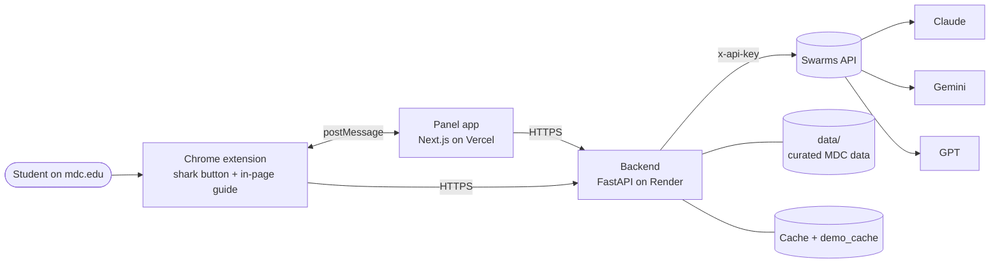

<div align="center">

# 🦈 AdByteSor

### Your AI advising team, right on mdc.edu

A Chrome extension that turns "I don't know where to start" into a clear, personalized roadmap, one that **always starts at a real Miami Dade College program**.

🥇 **1st Place, MDC North Campus Challenge** · 🥉 **3rd Place, Best Use of the Swarms API**
*SharkByte 2026, Miami Dade College*


[**GitHub repo**](https://github.com/TheJollyFool/SharkByte-Hackathon)

</div>

---

## 💡 The problem

Planning a career at MDC means piecing together programs, courses, tuition, financial aid and transfer rules from dozens of web pages. First-generation and working students, in particular, often don't know where to start, and a wrong first step costs time and money.

## ✨ What AdByteSor does

A shark 🦈 button appears on **mdc.edu**. The student opens it and picks one of two modes:

| Mode | How it works |
|---|---|
| 💬 **Group Chat** | Add AI advisors like friends in a WhatsApp group. Each one owns a part of the journey and answers in turns (one message each), with tokens and cost shown per message. |
| 🧬 **Mixture of Agents** | All selected advisors work together and their answers are merged into **one best answer**. |

When the student is ready, they get:

1. 🗺️ **A flowchart roadmap**: short, medium and long routes. Every route starts at a real MDC program, with time, cost, financial aid and job entry points. Downloadable as **PDF**.
2. 📅 **A semester-by-semester course plan** for any program in the roadmap.
3. 👆 **An in-page guide**: click a box and the panel closes; a highlight and speech bubble show what to click or type on the real mdc.edu page until the student reaches that program, course or certificate.
4. 🌎 **English and Spanish**, including students' typos ("sybersecurity" still works).

## 🧑‍🏫 The six advisors

Each advisor owns one section of the MDC challenge and runs on a different model, all through one Swarms API key.

| | Advisor | What it covers | Model |
|---|---|---|---|
| 🧭 | **Career Explorer** | The job, requirements, pay in Miami | Gemini 2.5 Flash |
| 🎓 | **MDC Pathway Advisor** | Which MDC program to start with and where it leads | Claude Sonnet |
| ⏱️ | **Time & Cost Analyst** | How long each stage takes and what it costs | GPT-5.4 |
| 💸 | **Financial Aid Advisor** | Pell, Bright Futures, FAFSA, work-study | GPT-5.5 |
| 🛠️ | **Professional Development Coach** | Certifications, internships, résumé prep | Claude Haiku |
| 🔀 | **Alternative Paths Scout** | Other routes to the same goal | GPT-5.4 mini |

## 🏗️ Architecture



| Folder | What |
|---|---|
| [`extension/`](extension/) | Chrome MV3 extension: shark button, iframe panel, in-page guide overlay |
| [`frontend/`](frontend/) | Next.js panel: mode picker, group chat, mixture, flowchart, PDF |
| [`backend/`](backend/) | FastAPI service that calls the Swarms API (the only place the key lives) |
| [`data/`](data/) | Hand-curated MDC programs, courses, costs, transfer agreements, financial aid |
| [`shared/`](shared/) | Roadmap JSON schema, mock fixtures, pre-recorded guides |
| [`docs/`](docs/) | Product, contracts, architecture, agents, team plan, demo script |

## ⚙️ Backend: how the AI works

Only the backend talks to Swarms. Endpoints:

| Endpoint | Purpose |
|---|---|
| `GET /health`, `GET /advisors` | Status and the advisor list |
| `POST /chat/reply` | One advisor's turn in the group chat (`/v1/agent/completions`) |
| `POST /mixture` | All advisors merged into one answer (`/v1/swarm/completions`, MixtureOfAgents) |
| `POST /roadmap` | Generates the flowchart roadmap, `GET /roadmap/{id}` fetches it |
| `POST /navigate` | Decides the next click or typing step for the in-page guide |
| `GET /programs/{id}/plan` | Semester-by-semester course plan |

**Reliability tricks we built:**

- ✅ **Grounded in real data**: agents only pick from the 300+ real MDC programs injected into the prompt; the first step of every route is forced to a real program with its `source_url`.
- ✅ **Schema-validated roadmaps**: Writer agent → Pydantic validation → one JSON-repair call → closest fixture as last resort.
- ✅ **Never block the demo**: disk cache keyed by request hash, committed `demo_cache/`, and `DEMO_MODE=true` serves only cached or fixture data.
- ✅ **Backup-model retry**: if a provider fails (quota, 503), the call is retried once on a backup model.
- ✅ **Typo tolerance**: fuzzy matching and aliases map "sybersecurity" to Cybersecurity.
- ✅ **Honest data**: any number not from `data/` is flagged `"estimate": true`; limited-access majors get a warning.

## 🚀 Run it locally

```bash
git clone https://github.com/TheJollyFool/SharkByte-Hackathon.git
cd SharkByte-Hackathon
cp .env.example .env            # add SWARMS_API_KEY (backend only, never commit it)
```

**Backend**

```bash
cd backend && python -m venv .venv && source .venv/bin/activate
pip install -r requirements.txt
uvicorn app.main:app --reload --port 8000
```

**Panel**

```bash
cd frontend && npm install && npm run dev      # http://localhost:3000
```

**Extension**: open `chrome://extensions`, enable *Developer mode*, click *Load unpacked*, and select `extension/` (set `PANEL_ORIGIN` in `extension/config.js`).

**No API credits?** Use `DEMO_MODE=true` (backend) or `NEXT_PUBLIC_USE_MOCK=true` (panel) to run on cache and fixtures.

## 👥 Team

| | Role |
|---|---|
| **Adrian Perez Galindo** | Chrome extension and in-page guide |
| **Robert Cifuentes** | Panel app (chat, mixture, flowchart, PDF) |
| **Piero Espinoza** | Backend and Swarms API orchestration |
| **Diego Rios** | MDC data, agent prompts, pitch |

## 📚 Docs

[Product spec](docs/PRODUCT.md) · [Contracts](docs/CONTRACTS.md) · [Architecture](docs/ARCHITECTURE.md) · [Agent pipeline](docs/AGENT_PIPELINE.md) · [Demo script](docs/DEMO.md) · [Agent instructions](AGENTS.md)

## 🙏 Thanks

To **INIT MDC North** and **Miami Dade College** for SharkByte 2026, **The Swarms Corporation** for the API challenge, and Base44, Major League Hacking, prune., Blackstone, EC-Council, Microsoft and all sponsors.

<div align="center">

*Built in a weekend. 🦈*

</div>
