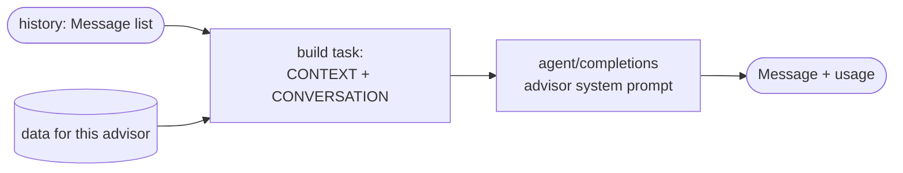

# Agent Pipeline (Swarms API)

Base: `https://api.swarms.world` · Header: `x-api-key: $SWARMS_API_KEY` · Docs: https://docs.swarms.ai
Only the backend calls Swarms. Shapes below follow the official SharkByte slides; **verify the real
response shape on the first call and write it down here** (section "Observed responses").

## Endpoints we use

| Endpoint | Used for |
|---|---|
| `POST /v1/agent/completions` | one advisor turn (group chat), Roadmap Writer, Navigator, JSON repair |
| `POST /v1/swarm/completions` with `swarm_type: "MixtureOfAgents"` | Mixture mode |
| `GET /v1/models/available`, `GET /v1/models/pricing` | pick model names |
| `GET /v1/usage/costs`, `GET /v1/account/credits` | watch spend |

From the slides — a swarm call:
```python
swarm = {
  "name": "...", "swarm_type": "MixtureOfAgents", "task": "...",
  "agents": [{"agent_name": "...", "model_name": "gpt-5.4-mini", "system_prompt": "..."}],
}
r = requests.post(f"{BASE}/v1/swarm/completions", headers=HEADERS, json=swarm)
r.json()["output"]
```
Response envelope (slides): `{job_id, success, name, output | outputs, usage: {input_tokens, output_tokens, total_tokens, total_cost}, timestamp}`.

## Agents

| Agent | Where | Call | Output |
|---|---|---|---|
| 6 advisors (`career`, `pathway`, `cost`, `finaid`, `prodev`, `alternatives`) | group chat | `agent/completions`, one per turn | short chat message (plain text / light markdown) |
| same 6 advisors + aggregator | mixture | `swarm/completions` `MixtureOfAgents` | one merged chat message |
| `Roadmap Writer` | "ready to go deeper" | `agent/completions` | **JSON only**, matches `shared/roadmap.schema.json` |
| `Navigator` | in-page guide | `agent/completions` | **JSON only**, a `NavStep` (see CONTRACTS.md) |
| `JSON Repair` | fallback | `agent/completions` | fixed JSON |

Advisor list (names, order, models): [data/advisors.json](../data/advisors.json). System prompts:
`backend/app/swarm/prompts.py`, one constant per agent.

### Group chat turn (`POST /chat/reply`)

Task string:
```
LANGUAGE: {en|es}
YOU ARE IN A GROUP CHAT WITH: {names of the selected advisors}
MDC DATA (use only these MDC programs; say "I don't have that data" otherwise): {filtered json}
CONVERSATION:
Student: ...
Career Explorer: ...
Student: <latest message>
Now reply as {advisor name}. One message, max ~120 words. Don't repeat what others said; add your part.
```
Usage for the `UsageBadge` comes from the response `usage` (`total_cost` → `cost_usd`).

### Mixture (`POST /mixture`)
```json
{
  "name": "shark-advisors-mixture",
  "swarm_type": "MixtureOfAgents",
  "task": "<same task string, last line: 'Give the student ONE merged, best answer.'>",
  "agents": [ /* the selected advisors */,
    {"agent_name": "Aggregator", "model_name": "$MODEL_AGGREGATOR",
     "system_prompt": "Merge the experts into one clear plan for the student. Keep MDC as step 1. Max 200 words."}],
  "max_loops": 1
}
```
Check on the first call how Swarms picks the aggregator (some versions use the last agent; others take an
`aggregator_agent`/`rules` field — see `GET /v1/swarms/available` and the docs) and note it below.

### Roadmap Writer (`POST /roadmap`)
Input: whole conversation + MDC data (`mdc_programs`, `transfer_agreements`, `costs`, `financial_aid`).
Prompt rules:
- Output **only** a JSON object matching the schema. No prose, no markdown fences.
- 2–4 routes (`short`, `medium`, `long`). **First step of every route = an MDC program from MDC DATA**
  (`kind: "mdc_program"`, `program_id` from the list, its `source_url`).
- Step `id` = `"{route.id}-{index}"`. Fill `kind` for every step.
- Any number not taken from MDC DATA → `"estimate": true`.
- Add `warnings` for limited-access majors (e.g. Architecture and Nursing at FIU are not guaranteed by
  Connect4Success) and when data is missing.
- `net_cost_after_aid_usd`: only if the conversation had the Financial Aid Advisor; always an estimate.
Validate with the Pydantic model → invalid: one `JSON Repair` call → still invalid: closest fixture,
`source: "fallback"`.

### Navigator (`POST /navigate`)
System prompt essentials:
```
You guide a student on mdc.edu to a goal. You get the goal, the current page URL/title and a list of
visible interactive elements with ids. Reply ONLY with JSON:
{"action": "click|type|scroll|done|open_url", "element_id": "...", "text_to_type": "...", "url": "...", "bubble": "..."}
- Pick exactly one element from the list (never invent ids).
- Prefer the site search box when no link clearly leads to the goal: action "type" with a short query.
- "done" when the current page is the goal page.
- bubble: max 12 words, in {language}, friendly.
```
Backend checks `element_id ∈ page.elements`; else retry once; else `open_url` with `goal.url`.
Use a cheap fast model; this is called on every page load.

## Models (`.env`)
One env var per agent (`MODEL_CAREER`, `MODEL_PATHWAY`, …, `MODEL_AGGREGATOR`, `MODEL_WRITER`,
`MODEL_NAVIGATOR`). Dev: cheapest model everywhere. Demo: stronger model for Writer and Aggregator.
Different models per advisor is allowed and nice to show on the advisor cards.

## Cost control
- `max_tokens`: chat reply ≈ 300, aggregator ≈ 600, writer ≈ 4000, navigator ≈ 200.
- Disk cache keyed by `sha256(endpoint + normalized request)`; `DEMO_MODE=true` serves only cache/fixtures.
- Inject only the data relevant to the career being discussed (filter `mdc_programs` by keywords).
- Tests mock HTTP — never hit Swarms in tests.

## Observed responses
_Fill this in after the first real call of each endpoint (paste a trimmed example)._
- `agent/completions`: TODO
- `swarm/completions` MixtureOfAgents: TODO
