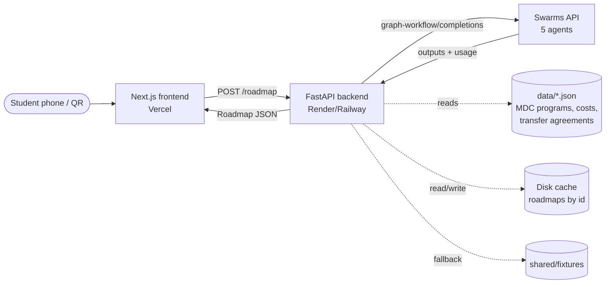
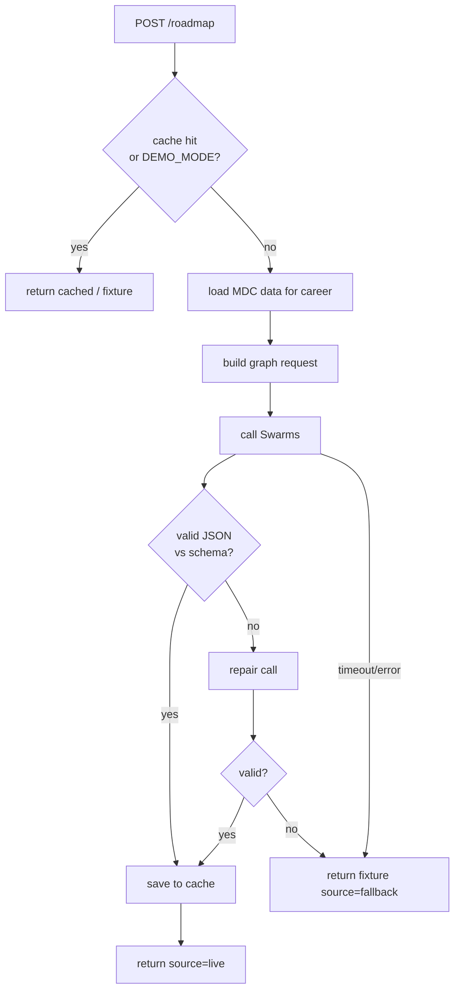

# Architecture



Contracts for every endpoint: [CONTRACTS.md](CONTRACTS.md).

## Request flow
1. Frontend sends `{career, preferences}` to `POST /roadmap`.
2. Backend computes `cache_key = sha256(normalized career + preferences)`.
   - Hit → return cached roadmap. `DEMO_MODE=true` → return fixture.
3. Backend loads relevant MDC programs from `data/` (filter by career keywords / `careers.json` mapping)
   and builds the graph workflow body (see [AGENT_PIPELINE.md](AGENT_PIPELINE.md)).
4. Calls Swarms with `httpx` (timeout ~120 s, 1 retry).
5. Reads `outputs["Roadmap Writer"]`, extracts the JSON, validates it with the Pydantic `Roadmap` model.
   - Invalid → one repair attempt (single cheap agent: "fix this JSON to match the schema"), else fallback fixture.
6. Adds `id`, `usage` (tokens, cost), stores in cache, returns.
7. `GET /roadmap/{id}` serves the cached result for share links / QR codes.



## Backend module layout (planned)
```
backend/app/
  main.py          FastAPI app, CORS, routers
  config.py        pydantic-settings (reads .env)
  data_loader.py   loads data/*.json once at startup
  api/             routers: health, careers, roadmap
  swarm/           client.py (httpx call), graph.py (builds agents/edges), prompts.py
  models/          roadmap.py (Pydantic mirror of shared/roadmap.schema.json)
  services/        roadmap_service.py (cache → swarm → validate → store)
```

## Frontend layout (planned)
```
frontend/
  app/page.tsx                 landing + career search
  app/plan/page.tsx            preferences form
  app/r/[id]/page.tsx          results (shareable)
  components/RouteCard.tsx, Timeline.tsx, AgentGraph.tsx, ShareQR.tsx
  lib/api.ts, lib/types.ts, lib/mock.ts
```

## Deploy
- Frontend: Vercel (`frontend/` as root dir). Env: `NEXT_PUBLIC_API_URL`.
- Backend: Render or Railway web service, start `uvicorn app.main:app --host 0.0.0.0 --port $PORT`.
- Domain (stretch): GoDaddy domain → Vercel.
