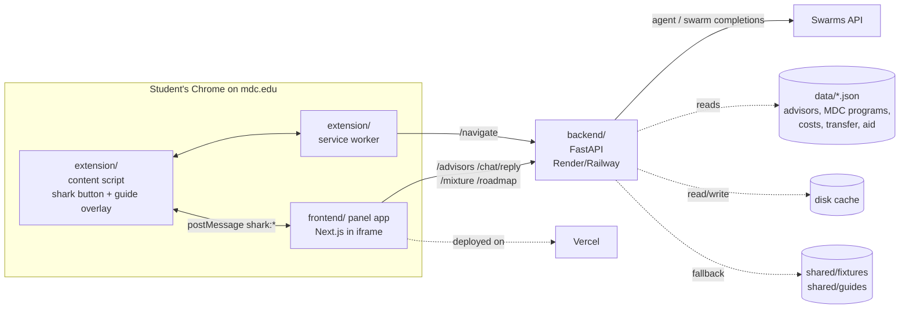
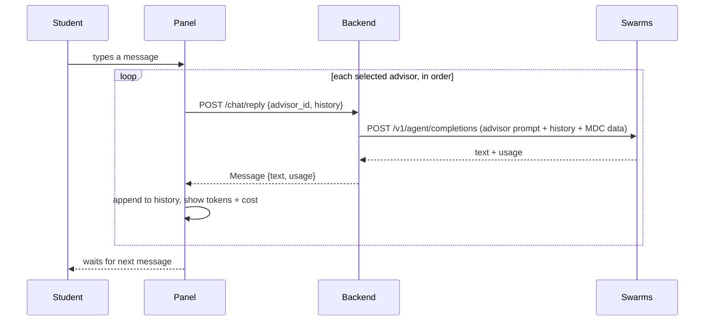
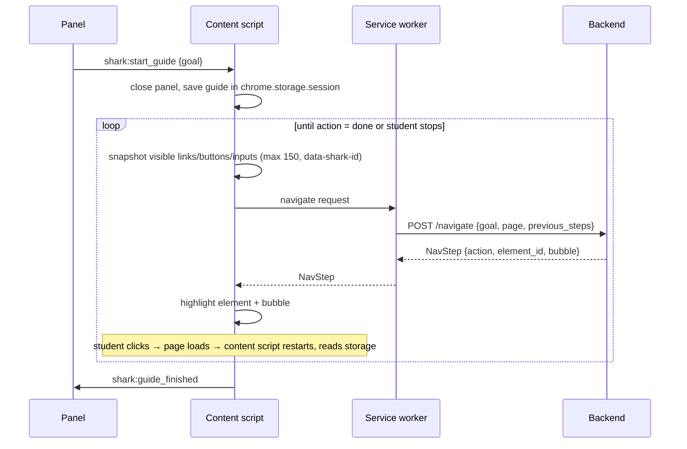

# Architecture



Contracts for every arrow: [CONTRACTS.md](CONTRACTS.md). Agents and Swarms calls: [AGENT_PIPELINE.md](AGENT_PIPELINE.md).

## Parts

| Part | Folder | Stack | Runs on |
|---|---|---|---|
| Extension | `extension/` | Chrome Manifest V3, plain TypeScript or JS (no framework needed), built with Vite or no build | Student's Chrome (load unpacked) |
| Panel app | `frontend/` | Next.js (App Router) + TypeScript + Tailwind; React Flow for the flowchart; html-to-image + jsPDF (or `window.print`) for PDF | Vercel |
| Backend | `backend/` | Python 3.11, FastAPI, httpx, Pydantic v2 | Render / Railway |
| Data | `data/` | Hand-curated JSON from mdc.edu, every entry with `source_url` | read by backend |
| Shared | `shared/` | JSON schema, fixtures, pre-recorded guides | all |

## Main flows

### Group chat round


### Mixture
`POST /mixture` → backend calls `POST /v1/swarm/completions` with `swarm_type: "MixtureOfAgents"` →
one aggregated `Message` with total usage.

### Roadmap
`POST /roadmap {history}` → Roadmap Writer agent turns the conversation + MDC data into JSON matching
`shared/roadmap.schema.json` → validate → repair once → else fixture. Panel renders it with React Flow
(one lane per route, one node per step, entry points as badges on edges).

### In-page guide

If `/navigate` fails → pre-recorded guide from `shared/guides/` → else "Open page directly".

## Backend module layout (planned)
```
backend/app/
  main.py            FastAPI app, CORS (panel origin + chrome-extension://*), routers
  config.py          pydantic-settings (reads .env)
  data_loader.py     loads data/*.json once at startup
  api/               health.py, advisors.py, chat.py, mixture.py, roadmap.py, navigate.py
  swarm/             client.py (httpx), prompts.py (one constant per agent), builders.py
  models/            messages.py, roadmap.py (mirror of the schema), navigate.py
  services/          chat_service.py, mixture_service.py, roadmap_service.py, navigate_service.py, cache.py
```

## Frontend layout (planned)
```
frontend/
  app/page.tsx                 mode picker (Group Chat / Mixture) + language toggle
  app/group/new/page.tsx       "New group" advisor picker
  app/chat/page.tsx            group chat
  app/mixture/page.tsx         mixture answer
  app/roadmap/[id]/page.tsx    flowchart + PDF download
  components/ AdvisorCard, ChatBubble, UsageBadge, TypingIndicator, Flowchart, StepNode, Warnings
  lib/ api.ts, types.ts, mock.ts, shark-bridge.ts (postMessage helpers), i18n.ts
```
Panel width is ~400 px: design for that (it behaves like a phone screen).

## Extension layout (planned)
```
extension/
  manifest.json      MV3; content_scripts on *://*.mdc.edu/*; host_permissions for backend URL
  content.ts         shark button, iframe panel, postMessage bridge, page snapshot, guide overlay
  background.ts      service worker: calls /navigate (avoids CORS issues from the page)
  overlay.css        highlight ring + bubble (scoped class names, prefix "shark-")
  config.ts          PANEL_ORIGIN, API_URL, MOCK_NAVIGATE
```

## Deploy
- Panel: Vercel (`frontend/` root). Env: `NEXT_PUBLIC_API_URL`, `NEXT_PUBLIC_USE_MOCK`.
  Must allow being framed by mdc.edu: header `Content-Security-Policy: frame-ancestors https://*.mdc.edu`.
- Backend: Render/Railway, `uvicorn app.main:app --host 0.0.0.0 --port $PORT`.
- Extension: `chrome://extensions` → Developer mode → Load unpacked → `extension/` (or its `dist/`).

## Known risks
- **Framing:** checked 2026-11-07, `www.mdc.edu` sends no `Content-Security-Policy` / `X-Frame-Options`,
  so injecting our iframe works. If some MDC subdomain blocks it, iframe an extension page
  (`panel.html` in `web_accessible_resources`) that itself iframes the Vercel app.
- **mdc.edu changes:** pre-recorded guide selectors can break; re-check on demo morning.
- **Live LLM latency:** a 6-advisor round is 6 sequential calls; keep `max_tokens` low (≈300 per chat
  reply) and cache the demo script.
