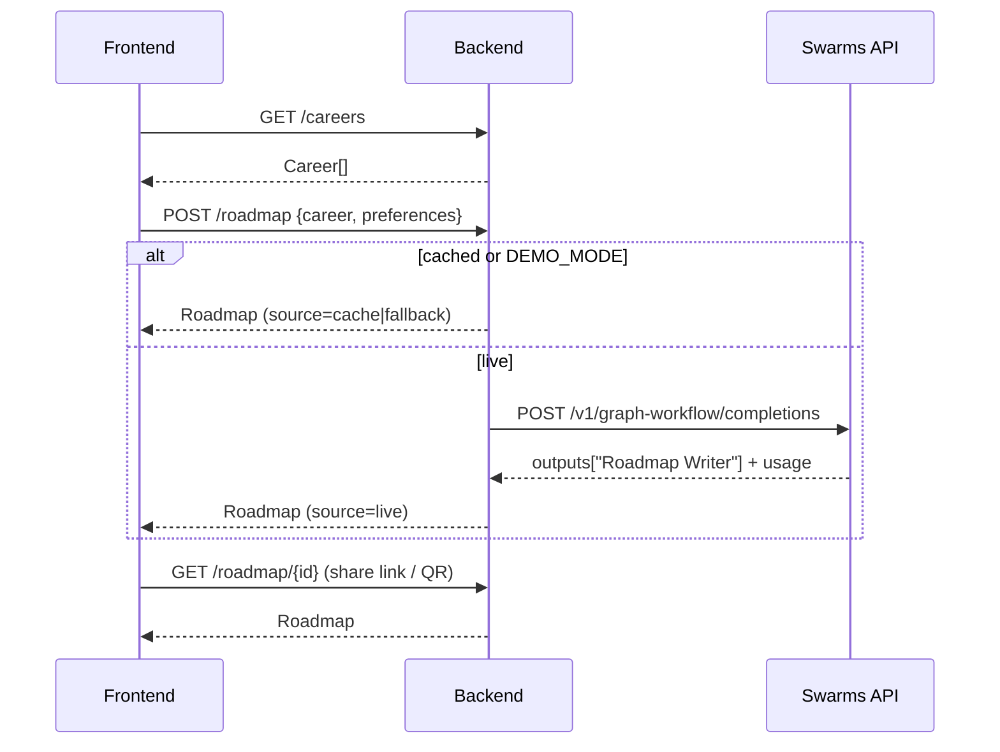

# API Contracts (backend ↔ frontend)

Base URL: `NEXT_PUBLIC_API_URL` (dev: `http://localhost:8000`). JSON everywhere.
The `Roadmap` shape is defined in [shared/roadmap.schema.json](../shared/roadmap.schema.json);
this file defines the endpoints around it. **Change a contract = update this file + schema +
fixtures + both sides in the same PR, and tell the team.**



## `GET /health`
`200` → `{ "status": "ok", "demo_mode": false }`

## `GET /careers`
`200` → list from `data/careers.json`
```json
[{ "id": "cybersecurity", "title": "Cybersecurity Specialist" }]
```

## `POST /roadmap`
Request:
```json
{
  "career": "cybersecurity",              // career id from /careers OR free text
  "preferences": {
    "budget": "low | medium | high",      // optional, default "medium"
    "pace": "fastest | balanced | thorough", // optional, default "balanced"
    "schedule": "full_time | part_time",  // optional, default "full_time"
    "existing_credits": 0                 // optional, default 0
  }
}
```
`200` → `Roadmap` (schema), always with `id` and `source` set.
Generation can take 30–90 s live; frontend shows the agents panel while waiting.

## `GET /roadmap/{id}`
`200` → `Roadmap` · `404` → error (see below)

## Errors (all endpoints)
```json
{ "error": { "code": "not_found | invalid_request | upstream_failed | timeout", "message": "human readable" } }
```
| HTTP | code | When |
|---|---|---|
| 400 | `invalid_request` | bad body / unknown enum value |
| 404 | `not_found` | roadmap id not in cache |
| 502 | `upstream_failed` | Swarms failed **and** no fallback fixture exists |
| 504 | `timeout` | Swarms timed out **and** no fallback fixture exists |

Rule: if a fallback fixture exists, the backend returns `200` with `source: "fallback"` instead of an error.

## Frontend mock mode
With `NEXT_PUBLIC_USE_MOCK=true`, `lib/api.ts` returns `shared/fixtures/*.json` for the same calls,
so the UI never waits for the backend.
