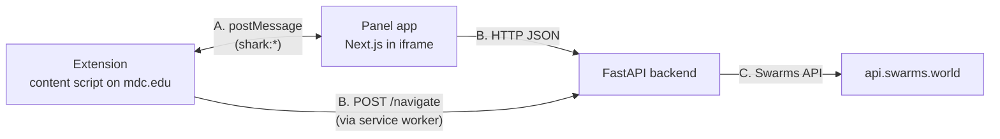

# Contracts

Three boundaries, three contracts. **Change a contract = update this file + `shared/` schema/fixtures +
both sides in the same PR, and tell the team.**



- **A. Extension ↔ Panel** — `window.postMessage` messages (section A).
- **B. Panel/Extension ↔ Backend** — HTTP endpoints (section B). Base URL `NEXT_PUBLIC_API_URL` (dev `http://localhost:8000`).
- **C. Backend ↔ Swarms** — see [AGENT_PIPELINE.md](AGENT_PIPELINE.md). Only the backend holds the key.

---

## Shared types

TypeScript notation; the backend mirrors them in Pydantic (`backend/app/models/`). The roadmap shape is
[shared/roadmap.schema.json](../shared/roadmap.schema.json).

```ts
type Language = "en" | "es";
type Source = "live" | "cache" | "fallback";
type AdvisorId = "career" | "pathway" | "cost" | "prodev" | "alternatives" | "finaid";

interface Advisor {
  id: AdvisorId;
  name: string;            // "Career Explorer"
  role: string;            // one line shown in the "New group" screen
  mdc_section: string;     // "§1 Career exploration"
  emoji: string;           // avatar placeholder, e.g. "🧭"
  color: string;           // hex, chat bubble accent
  order: number;           // turn order in the group chat (1 = first)
  model_name: string;      // shown small on the advisor card
}

interface Usage {
  input_tokens: number;
  output_tokens: number;
  total_tokens: number;
  cost_usd: number;
}

interface Message {
  id: string;
  role: "student" | "advisor" | "aggregator";
  advisor_id?: AdvisorId;           // when role = "advisor"
  contributors?: AdvisorId[];       // when role = "aggregator"
  text: string;                     // markdown allowed (bold, lists, links)
  usage?: Usage;                    // absent on student messages
  source?: Source;
  created_at: string;               // ISO 8601
}
```

The **frontend owns the conversation** (keeps `Message[]` in state); the backend is stateless except for
caches. Every request sends the history it needs.

---

## B. HTTP endpoints

### `GET /health`
`200` → `{ "status": "ok", "demo_mode": false }`

### `GET /advisors`
`200` → `Advisor[]` sorted by `order` (source: `data/advisors.json`).

### `POST /chat/reply` — one advisor's turn (Group Chat)
The **frontend runs the turn loop**: after the student sends a message, it calls this endpoint once per
selected advisor, in `order`, appending each reply to the history before the next call. This gives a
typing indicator per advisor and per-message usage without streaming.

Request:
```json
{
  "advisor_id": "pathway",
  "group": ["career", "pathway", "cost"],
  "language": "es",
  "history": [ /* Message[] — whole conversation so far, including this round's earlier replies */ ]
}
```
`200` → `Message` (`role: "advisor"`, `usage` and `source` set).

### `POST /mixture` — merged answer (Mixture of Agents)
Request:
```json
{
  "advisors": ["career", "pathway", "cost", "prodev", "alternatives", "finaid"],
  "language": "en",
  "history": [ /* Message[]; last item is the new student message */ ]
}
```
`200` →
```json
{
  "message": { /* Message with role "aggregator", contributors[], usage = total of the whole swarm */ },
  "per_agent_usage": { "career": { /* Usage */ }, "pathway": { /* Usage */ } }
}
```
`per_agent_usage` is best effort: `{}` if Swarms only returns a total.

### `POST /roadmap` — "I'm ready to go deeper"
Request:
```json
{ "mode": "group_chat | mixture", "language": "en", "history": [ /* Message[] */ ] }
```
`200` → `Roadmap` (schema), always with `id`, `source`, `usage`. Live generation 15–60 s; show a loader.

### `GET /roadmap/{id}`
`200` → `Roadmap` · `404` → `not_found`

### `POST /navigate` — next step of the in-page guide
Called by the extension (service worker) on every page load/change while a guide is active.

Request:
```json
{
  "goal": { "label": "Cybersecurity A.S.", "kind": "mdc_program", "url": "https://www.mdc.edu/...", "step_id": "short-0" },
  "language": "en",
  "page": {
    "url": "https://www.mdc.edu/",
    "title": "Miami Dade College",
    "elements": [
      { "id": "e1", "tag": "a", "text": "Academics", "href": "/academics/" },
      { "id": "e2", "tag": "input", "type": "search", "placeholder": "Search mdc.edu" }
    ]
  },
  "previous_steps": [ /* NavStep[] already shown in this guide */ ]
}
```
Rules for `page.elements`: only visible, interactive elements (`a`, `button`, `input`, `select`,
`[role=button]`); max **150**; `text` trimmed to 80 chars; `id` is assigned by the content script
(`data-shark-id` attribute) so it can find the element again.

`200` → `NavStep`:
```ts
interface NavStep {
  action: "click" | "type" | "scroll" | "done" | "open_url";
  element_id?: string;     // for click / type / scroll — an id from page.elements
  text_to_type?: string;   // for type
  url?: string;            // for open_url (fallback when no element helps)
  bubble: string;          // what the student reads: "Click Academics"
  usage?: Usage;
  source?: Source;
}
```
`done` = the student is on the goal page. The backend must reject an `element_id` that is not in
`page.elements` (retry once, else `open_url` with `goal.url`).

### Errors (all endpoints)
```json
{ "error": { "code": "not_found | invalid_request | upstream_failed | timeout", "message": "human readable" } }
```
| HTTP | code | When |
|---|---|---|
| 400 | `invalid_request` | bad body / unknown enum value / unknown advisor |
| 404 | `not_found` | roadmap id not in cache |
| 502 | `upstream_failed` | Swarms failed **and** no fallback exists |
| 504 | `timeout` | Swarms timed out **and** no fallback exists |

Rule: if a cached/fixture answer exists, return `200` with `source: "fallback"` instead of an error.

### Frontend mock mode
With `NEXT_PUBLIC_USE_MOCK=true`, `lib/api.ts` returns `shared/fixtures/*` for every call
(`chat_reply.example.json`, `mixture.example.json`, roadmap fixtures) plus `data/advisors.json`, so the UI never
waits for the backend. The extension has the same idea: `MOCK_NAVIGATE=true` uses
`shared/fixtures/navigate.example.json` and pre-recorded guides.

---

## A. Extension ↔ Panel messages

The panel is an iframe (our Vercel origin) injected by the content script. They talk with
`window.postMessage`. Every message has `source: "shark"`. **Both sides must check `event.origin`**
(content script accepts only `PANEL_ORIGIN`; panel accepts only `https://*.mdc.edu`).

| type | Direction | Payload | Meaning |
|---|---|---|---|
| `shark:ready` | panel → ext | `{}` | panel loaded |
| `shark:close` | panel → ext | `{}` | close the panel (conversation stays in panel state) |
| `shark:start_guide` | panel → ext | `{ goal: { label, kind, url, step_id }, language }` | close panel, start in-page guide |
| `shark:open_url` | panel → ext | `{ url }` | navigate the tab directly (fallback button) |
| `shark:guide_finished` | ext → panel | `{ step_id, status: "done" \| "stopped" \| "failed" }` | guide ended; panel can show ✓ on that box |
| `shark:page_context` | ext → panel | `{ url, title }` | current mdc.edu page (optional, advisors may use it) |

Example:
```js
// panel
window.parent.postMessage({ source: "shark", type: "shark:start_guide",
  goal: { label: "Cybersecurity A.S.", kind: "mdc_program", url: "https://www.mdc.edu/...", step_id: "short-0" },
  language: "en" }, "https://www.mdc.edu");
```

### Guide state across page loads
A click on mdc.edu reloads the page and the content script. The active guide lives in
`chrome.storage.session` (`{ goal, language, previous_steps, started_at }`); on each load the content
script checks it, snapshots the page and calls `/navigate`. "Stop guide" clears it.

### Pre-recorded guides (fallback)
`shared/guides/<id>.json`, used when `/navigate` fails or for the scripted demo:
```json
{
  "id": "cybersecurity-as",
  "goal_step_ids": ["short-0"],
  "steps": [
    { "url_pattern": "https://www.mdc.edu/", "selector": "a[href*='academics']", "action": "click", "bubble": "Click Academics" }
  ]
}
```
Selectors are filled in by hand by visiting mdc.edu (they break if MDC changes its site — check on demo morning).
