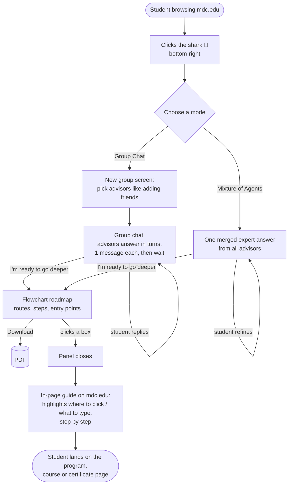

# Product Spec — Shark Advisor (working name, final name TBD)

## Problem
A student on mdc.edu who wants to become an architect, engineer, chef or cybersecurity specialist
doesn't know which MDC program to start with, what comes after, how long it takes, what it costs,
or even where on the website to find it. The information exists but is scattered across catalog
pages, transfer agreements, tuition tables and job sites.

## Solution (one sentence)
A shark 🦈 button that lives on mdc.edu (Chrome extension): the student talks to a **group chat of
AI advisors** (or gets one **merged expert answer**), receives a **clickable flowchart roadmap**
that starts at MDC, and then gets **guided step by step on the real mdc.edu page** to each program,
course or certificate in that roadmap.

## Target user
High school senior or new MDC student browsing mdc.edu, no prior knowledge of college programs.
Speaks English, Spanish, or both.

## User flow

### 1. Entry — the shark on mdc.edu
- Chrome extension (Manifest V3) injects a floating shark button bottom-right on `*.mdc.edu`.
- Click → a side panel opens with our web app inside (iframe). The extension adds **an overlay only**;
  it never copies or restyles MDC's site.

### 2. Mode A — Group Chat ("agents discuss in turns")
- First a **"New group"** screen, like creating a WhatsApp group: the student picks which advisors to
  add as "friends" (default: all of them).
- Each advisor is a specialized AI agent that owns one part of the MDC challenge (see table below).
- **Turn rule:** after each student message, every advisor in the group answers **once**, in a fixed
  order, and can read what the previous advisors said. Then all wait for the student.
- Under every advisor message, in small text: **tokens used and cost (USD)** of that message.
- Header shows the running total for the conversation.

### 3. Mode B — Mixture of Agents ("an aggregator merges experts")
- No group setup: the same advisors work in the background and an **aggregator** merges them into
  one optimal answer.
- Shows total tokens and cost, plus a small "built from: Career, Pathway, Cost…" line.
- The student can reply to refine the answer.

### 4. "I'm ready to go deeper" → Flowchart
- Button visible in both modes once the advisors have proposed a path.
- Generates the full roadmap from the conversation: 2–4 routes (short / medium / long), each an
  ordered chain of boxes (MDC program → certifications → transfer → bachelor's → master's), with
  workforce entry points marked between boxes.
- Every box is clickable. Boxes show credential, duration, cost (labeled **estimate** when it is one).
- **Download as PDF** button.
- Warnings shown on top when they apply (e.g. "Architecture is limited-access: FIU Connect4Success
  does not guarantee admission to this major").

### 5. In-page guide (the "wow" moment)
- Click a box → the panel closes and a **pointer/coach overlay** appears on the real mdc.edu page:
  it highlights the element to click or the field to type in, with a bubble ("Click *Academics*",
  "Type *Cybersecurity* here"), one step at a time, until the student reaches the resource.
- How: the extension reads the visible links/buttons/inputs of the current page and asks the
  **Navigator** agent which one gets the student closer to the goal. On page change, repeat.
- Safety net: 2–3 **pre-recorded guides** for the demo path, and a "just open the page" button that
  goes straight to the box's `source_url`.

## The advisors (one per MDC requirement section)

| id | Advisor | Owns MDC section | Says things like |
|---|---|---|---|
| `career` | Career Explorer | §1 Career exploration | what the job is, responsibilities, qualifications, Miami salary/outlook, related careers |
| `pathway` | MDC Pathway Advisor | §2 Educational pathway starting at MDC | which MDC program to start with (certificate / A.S. / A.A.), transfer + articulation agreements, bachelor's, master's/doctoral |
| `cost` | Time & Cost Analyst | §3 Timeline and cost | months per stage, tuition per credit, total time and cost, full vs part time |
| `prodev` | Professional Development Coach | §4 Professional development | certifications, licenses, internships/apprenticeships, licensing exams, résumé/interview resources |
| `alternatives` | Alternative Paths Scout | §5 Alternative pathways | other routes to the same goal, entering the workforce early, alternative MDC programs |
| `finaid` | Financial Aid Advisor | §3 + "Actionable" | Pell Grant, Bright Futures, FAFSA, work-study, estimated cost after aid (always labeled estimate) |

Agent details, prompts and Swarms calls: [AGENT_PIPELINE.md](AGENT_PIPELINE.md).

## MDC Challenge requirements → how we cover each one

| # | MDC asks for | Our feature | Done? |
|---|---|---|---|
| 1 | **Career exploration** | Career Explorer advisor + career card at the top of the flowchart | [ ] |
| 2 | **Educational pathway starting at MDC** (incl. transfer/articulation, master's/doctoral) | MDC Pathway Advisor; first box of every route is a real MDC program; transfer boxes cite the agreement | [ ] |
| 3 | **Timeline and cost** | Time & Cost Analyst + Financial Aid Advisor; duration/cost on every box, totals per route | [ ] |
| 4 | **Professional development** | Professional Development Coach; certification/exam boxes; resources list | [ ] |
| 5 | **Alternative pathways** (multiple routes, work at different stages, alternative MDC programs) | Alternative Paths Scout; 2–4 routes; workforce entry points on the flowchart | [ ] |

### "What MDC is looking for" checklist (judging)
- [ ] **Easy to use** — lives where students already are (mdc.edu); plain-language chat; in-page guide
- [ ] **Personalized** — the conversation adapts to the student's career, goals, budget, schedule
- [ ] **Actionable** — every box leads to the real MDC page, with a guide to get there
- [ ] **Multiple pathways** — short credentials vs long degrees side by side
- [ ] **Starts at MDC** — every route's first box is an MDC program
- [ ] **Designed to grow** — data-driven + Navigator works on any mdc.edu page; adding a career = adding data

## Swarms Challenge angle
- Two real Swarms collaboration patterns the student can choose between: **GroupChat-style turns**
  and **MixtureOfAgents**.
- Per-agent **tokens + cost** visible on every message — shows the swarm is real and cheap to scale.
- A different model per advisor is possible (Swarms picks the model per agent).
- Navigator agent turns the roadmap into actions on a real website.

## Extras (all in MVP, small)
- **English / Spanish** toggle; advisors answer in the student's language.
- **Financial Aid Advisor** (team's own expertise — strong pitch point).
- **Honest warnings**: limited-access majors, estimates labeled as estimates, data gaps flagged
  instead of invented.
- **Cost display** per message and per conversation.
- **PDF download** of the flowchart.

## Out of scope
Accounts/login, saving history across devices, real-time seat availability, submitting financial aid
applications, editing or scraping MDC's site beyond reading the current page for the guide,
browsers other than Chrome.
