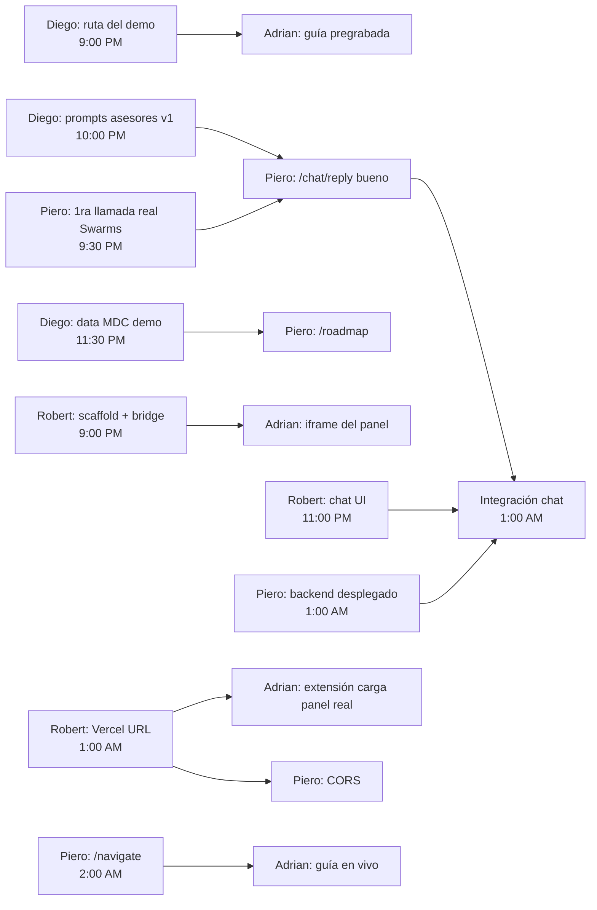

# Plan del equipo

> Cada uno trabaja en su branch `feat/<area>-<cosa>` y abre PRs chiquitos a `master`. Marquen `[x]` cuando
> terminen. Todos construyen contra los **mocks** de `shared/fixtures/` desde el minuto 1 — nadie espera a
> nadie. Contratos: [CONTRACTS.md](CONTRACTS.md). Brief detallado de cada rol: [roles/](roles/).

## Roles

| Rol | Persona | Dueño de | Brief |
|---|---|---|---|
| **1. Extensión + guía en la página** | **Adrian** | `extension/`, `shared/guides/` | [roles/rol1-adrian-extension.md](roles/rol1-adrian-extension.md) |
| **2. Panel app (frontend)** | **Robert** | `frontend/` | [roles/rol2-robert-panel.md](roles/rol2-robert-panel.md) |
| **3. Backend + Swarms** | **Piero** | `backend/`, `docs/AGENT_PIPELINE.md`, deploy backend | [roles/rol3-piero-backend.md](roles/rol3-piero-backend.md) |
| **4. Datos MDC + agentes + pitch** | **Diego** | `data/*.json`, `docs/agents/` (prompts), `docs/DEMO.md`, slides, Devpost | [roles/rol4-diego-data-pitch.md](roles/rol4-diego-data-pitch.md) |

Regla: los LLMs (Claude, Codex, Gemini) escriben el código leyendo `AGENTS.md` + su brief. Los humanos
deciden, revisan y prueban. El que se quede sin tokens pasa su tarea a otro modelo, no se para.
Merge a `master`: cualquiera puede mergear su propio PR si no rompe nada; cambios a `docs/CONTRACTS.md`
o al schema requieren OK de los dueños de ambos lados.

## Horario (sáb 7 → dom 8 nov)

| Hora | Fase | Meta |
|---|---|---|
| 7:45–8:15 PM | **0. Setup** | Mergear este spec a `master`, todos clonan, leen su brief, aprueban `REQUIREMENTS.md` |
| 8:15 PM–1:00 AM | **1. Partes con mocks** | Cada rol funciona solo, contra fixtures |
| 1:00–4:00 AM | **2. Integración** | Panel ↔ backend real, extensión ↔ panel desplegado, guía ↔ `/navigate` |
| 4:00–8:00 AM | **3. Pulido + demo** | Cachear guion, ensayar 3 veces. **Code freeze 8:00 AM** |
| 8:00–10:00 AM | Entrega | Video, Devpost (sube 10–11 AM, límite duro), slides |
| 1:30 PM | Judging | |

## Qué depende de qué (entregas entre personas)

| Quién entrega | A quién | Qué | Para cuándo |
|---|---|---|---|
| Diego | Adrian | Ruta exacta del demo: carrera, programa MDC, URL de su página, qué caja se clickea | **9:00 PM** |
| Robert | Adrian | `frontend/` corriendo en `localhost:3000` + `lib/shark-bridge.ts` pusheado | **9:00 PM** |
| Piero | todos | Primera llamada real a Swarms + respuesta anotada en AGENT_PIPELINE.md | **9:30 PM** |
| Diego | Piero | System prompts v1 de los 6 asesores (`docs/agents/`) | **10:00 PM** |
| Diego | Piero | `data/` real para la carrera del demo (programas, costos, transfer) | **11:30 PM** |
| Piero | Robert, Adrian | Backend desplegado (URL) con `/advisors` + `/chat/reply` | **1:00 AM** |
| Robert | Adrian, Piero | Panel desplegado en Vercel (URL, para iframe y CORS) | **1:00 AM** |
| Piero | Adrian | `/navigate` en vivo | **2:00 AM** |
| Diego | todos | Guion del demo final | **4:00 AM** |

## Prioridades (si vamos atrasados, se recorta de abajo hacia arriba)

1. **Group chat con tokens + costo** (panel + `/chat/reply`) — el corazón del Swarms challenge
2. **Flowchart desde la conversación** (que la primera caja sea un programa real de MDC) — el corazón del MDC challenge
3. **Extensión: tiburón + panel en mdc.edu**
4. **Guía en la página con guía pregrabada** (la ruta del demo)
5. Mixture mode
6. PDF
7. Guía en vivo con Navigator (`/navigate`)
8. Español
9. Costo después de ayuda financiera, modelos distintos por asesor

## Checklists por rol
Están en cada brief de [roles/](roles/). Marquen ahí.
