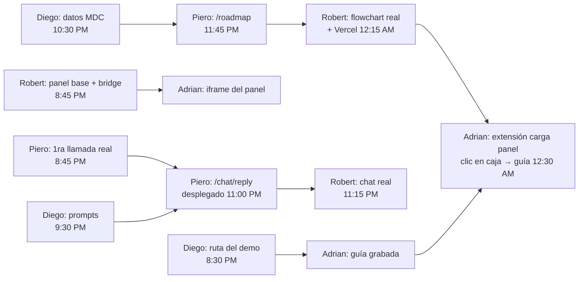

# Plan del equipo

> Cada uno trabaja en su branch `feat/<area>-<cosa>` y abre PRs chiquitos a `master`. Marquen `[x]` cuando
> terminen. Todos construyen contra los **mocks** de `shared/fixtures/` desde el minuto 1 — nadie espera a
> nadie. Contratos: [CONTRACTS.md](CONTRACTS.md). Brief detallado de cada rol: [roles/](roles/).

## Roles

| Rol | Persona | Dueño de | Brief |
|---|---|---|---|
| **1. Extensión + guía en la página** | **Adrian** | `extension/` (incl. `extension/guides/`) | [roles/rol1-adrian-extension.md](roles/rol1-adrian-extension.md) |
| **2. Panel app (frontend)** | **Robert** | `frontend/` | [roles/rol2-robert-panel.md](roles/rol2-robert-panel.md) |
| **3. Backend + Swarms** | **Piero** | `backend/`, `docs/AGENT_PIPELINE.md`, deploy backend | [roles/rol3-piero-backend.md](roles/rol3-piero-backend.md) |
| **4. Datos MDC + agentes + pitch** | **Diego** | `data/*.json`, `docs/agents/` (prompts), `docs/DEMO.md`, slides, Devpost | [roles/rol4-diego-data-pitch.md](roles/rol4-diego-data-pitch.md) |

Regla: los LLMs (Claude, Codex, Gemini) escriben el código leyendo `AGENTS.md` + su brief. Los humanos
deciden, revisan y prueban. El que se quede sin tokens pasa su tarea a otro modelo, no se para.
Merge a `master`: cualquiera puede mergear su propio PR si no rompe nada; cambios a `docs/CONTRACTS.md`
o al schema requieren OK de los dueños de ambos lados.

## Horario (sáb 7 → dom 8 nov) — code freeze 1:30 AM

| Hora | Bloque | Meta |
|---|---|---|
| 8:00–9:00 PM | **1. Arranque** | Llamada real a Swarms, panel base, ruta del demo, tiburón en mdc.edu |
| 9:00–11:00 PM | **2. Cada uno su parte** | Todo con mocks; backend con `/chat/reply` desplegado |
| 11:00 PM–12:30 AM | **3. Integración** | Chat real → `/roadmap` → flowchart real → Vercel → extensión carga el panel → guía grabada |
| 12:30–1:30 AM | **4. Cerrar** | Correr el guion, cachearlo, `DEMO_MODE`, solo arreglar lo que rompe el demo |
| **1:30 AM** | **Code freeze** | Todo pusheado a `master` |
| Dom mañana | Entrega | Ensayo en el laptop del stand, slides, video, Devpost (10–11 AM, límite duro). Judging 1:30 PM |

**Punto de control 11:00 PM:** ¿el chat responde con el backend real? Si no → se corta Mixture y el que esté
más libre se sienta con Piero hasta que funcione.

## Qué depende de qué (entregas entre personas)

| Hora | Quién entrega | A quién | Qué |
|---|---|---|---|
| **8:30 PM** | Diego | Adrian | Ruta exacta del demo: carrera, programa MDC, URL de su página, clics desde la home |
| **8:45 PM** | Robert | Adrian | `frontend/` corriendo en `localhost:3000` + `lib/shark-bridge.ts` pusheado |
| **8:45 PM** | Piero | todos | Primera llamada real a Swarms + respuesta anotada en AGENT_PIPELINE.md |
| **9:30 PM** | Diego | Piero | System prompts de los 6 asesores (`docs/agents/`) |
| **10:30 PM** | Diego | Piero | `data/` real para la carrera del demo |
| **11:00 PM** | Piero | Robert | Backend desplegado (URL) con `/advisors` + `/chat/reply` |
| **11:45 PM** | Piero | Robert | `/roadmap` en vivo |
| **12:15 AM** | Robert | Adrian, Piero | Panel en Vercel (URL: iframe y CORS) |
| **12:30 AM** | Adrian | todos | Demo completo en mdc.edu: tiburón → chat → flowchart → clic → guía |
| **12:30 AM** | Diego | todos | Guion del demo |

## Prioridades (si vamos atrasados, se recorta de abajo hacia arriba)

**MVP (tiene que estar a la 1:30 AM):**
1. **Group chat con tokens + costo** (panel + `/chat/reply`) — el corazón del Swarms challenge
2. **Flowchart desde la conversación** (primera caja = programa real de MDC) — el corazón del MDC challenge
3. **Extensión: tiburón + panel en mdc.edu**
4. **Guía grabada** de la ruta del demo
5. Mixture (después de que el chat funcione)
6. PDF (`window.print()` alcanza)

**Solo si sobra tiempo:** guía en vivo con Navigator (`/navigate`), español, costo después de ayuda
financiera, usage por agente en Mixture, modelos distintos por asesor, carreras extra.

## Checklists por rol
Están en cada brief de [roles/](roles/). Marquen ahí.
